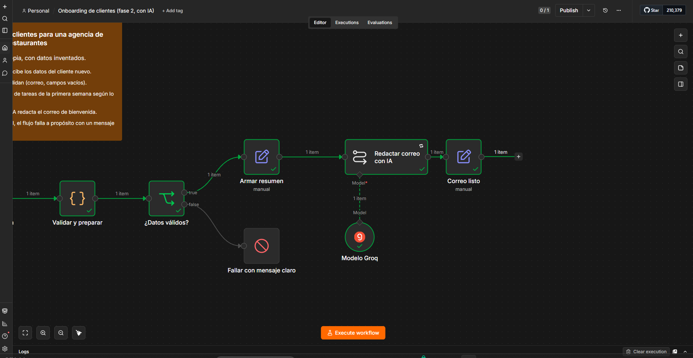
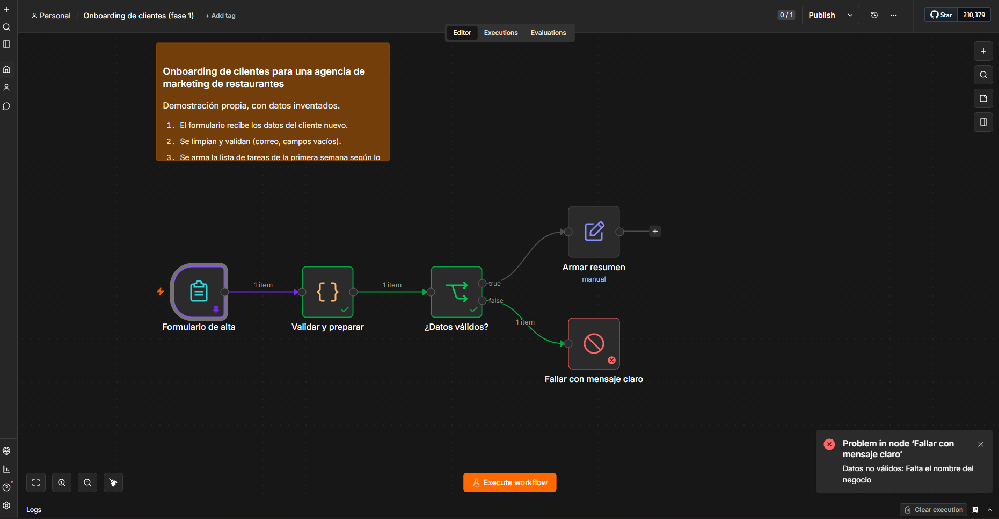

# Onboarding automático de clientes con n8n e IA

Pieza de portafolio. Un flujo de n8n para una agencia de marketing de restaurantes: recibe a un cliente nuevo por formulario, valida los datos, arma las tareas de la primera semana y redacta con IA un correo de bienvenida.

**Cómo se hizo:** el flujo se construye dirigiendo a Claude (IA) y se verifica probándolo en n8n. No está armado a mano nodo por nodo. Es una demostración propia, con datos inventados; no es trabajo para un cliente real.

## Qué hace

1. **Formulario de alta:** nombre del negocio, contacto, correo, tipo de negocio (restaurante, cafetería, bar, hotel con restaurante, food truck), necesidad principal y notas.
2. **Validación:** limpia los datos y comprueba el nombre del negocio, el de contacto y el correo. Si algo está mal, el flujo **falla a propósito** con un mensaje claro (por ejemplo "Datos no válidos: Falta el nombre del negocio") en vez de seguir con datos malos.
3. **Tareas de la primera semana:** una lista base (reunión de bienvenida, accesos y materiales, objetivos del mes) más tareas según la necesidad: redes sociales, campañas de correo, reportes, o las tres.
4. **Correo de bienvenida con IA:** un modelo de lenguaje redacta el correo con asunto, saludo por el nombre del contacto, 2 o 3 de las primeras tareas y firma. Las instrucciones le prohíben inventar precios, fechas, personas del equipo y promesas de resultados, y suponer el género del cliente.

## Cómo probarlo

Necesitas n8n (se probó en la versión 2.26.4, en Docker) y una cuenta de un servicio de IA compatible con el nodo de chat que uses.

1. En n8n: **Workflows**, menú de importar, **Import from file**, y elige `onboarding-clientes-con-ia.json`.
2. El archivo **no trae credenciales**. Abre el nodo **Modelo Groq**, crea tu propia credencial de Groq (la clave va solo en n8n, nunca en archivos) y elígela. El modelo usado fue `openai/gpt-oss-120b`; si ya no existe en tu cuenta, elige otro de texto en la lista.
3. Pulsa **Execute workflow**, rellena el formulario con datos inventados y mira el resultado en el nodo **Correo listo**.

## Qué está probado y qué no

**Probado:**
- Camino correcto: formulario con datos válidos, validación, resumen, redacción con IA y resultado final.
- Camino de error: con el nombre del negocio vacío, el flujo termina en el nodo de fallo con el mensaje esperado. Esa prueba se hizo fijando los datos de entrada a mano, porque el formulario de n8n ya impide enviar campos obligatorios vacíos. La captura de abajo se tomó en la versión anterior del mismo flujo (fase 1, sin el paso de IA); la parte de validación y el nodo de fallo son los mismos.
- El correo generado se revisó a mano: sin huecos por rellenar, sin precios ni fechas inventadas, sin suponer género. Se corrigieron dos fallos en el primer intento (género en el saludo y un hueco en la firma).

**Sin probar todavía:**
- Enviar el correo de verdad. Hoy el flujo solo redacta el correo; no lo envía.
- Crear las tareas en un gestor (por ejemplo Asana) y guardar los clientes en una tabla.
- Ejecutarlo en modo producción (flujo publicado y activo) y con muchas solicitudes seguidas.
- Otros modelos de IA, otros idiomas y otras versiones de n8n.

## Límites conocidos

- El correo lo redacta un modelo de lenguaje: puede variar entre ejecuciones y siempre conviene que una persona lo revise antes de enviarlo a un cliente real.
- Las tareas están definidas de forma fija en el nodo de código; para otra agencia hay que adaptarlas.
- Con los servicios de IA de cuota gratuita, lo que se envía puede ser usado por el proveedor. Por eso esta demo usa solo datos inventados y no debe usarse con datos reales de clientes sin revisar las condiciones del proveedor.

## Archivos

- `onboarding-clientes-con-ia.json`: el flujo, listo para importar y sin credenciales.
- `docs/`: capturas del flujo.
